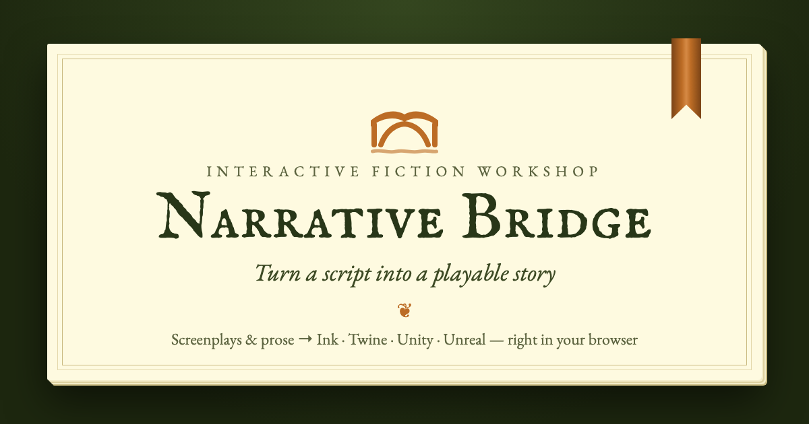

<p align="center"><a href="https://flamingairplane.github.io/Script-to-Game-Converter/"></a></p>

<p align="center"><b><a href="https://flamingairplane.github.io/Script-to-Game-Converter/">Open Narrative Bridge</a></b> · <a href="https://github.com/FlamingAirplane/Script-to-Game-Converter/releases">Download the offline edition</a> · <a href="docs/USER_GUIDE.md">User guide</a> · <a href="WRITERS.md">Quick start for writers</a></p>

# Narrative Bridge

Turn screenplays and prose into validated [Ink](https://github.com/inkle/ink) stories, then package them for **Unity**
(via [Ink Unity Integration](https://github.com/inkle/ink-unity-integration)) or **Unreal Engine**
(via [Inkpot](https://github.com/The-Chinese-Room/Inkpot)).

One source-processing pipeline → one canonical story model (ISR) → one generated Ink story → engine-specific export adapters.

Everything runs locally. Scripts never leave your machine.

**Try it online:** https://flamingairplane.github.io/Script-to-Game-Converter/ (the page runs entirely in your browser;
nothing is uploaded). After one visit it also works with no connection, and browsers offer to install it as an app
(see [`scripts/offline-site.ts`](scripts/offline-site.ts)); when a new version is deployed, the app offers to reload into it.
The site also offers the offline single-file edition for writers. It is rebuilt and redeployed by
[`.github/workflows/pages.yml`](.github/workflows/pages.yml) on every push to `main`.

## Quick start

New to the app? The [user guide](docs/USER_GUIDE.md) walks through every chapter with screenshots.

For development and the CLI you need [Node.js](https://nodejs.org) 22.13 or later (the PDF reader requires it). Writers
using the website or the offline file need nothing installed.

```bash
npm install
npm run dev        # web app at http://localhost:5173
npm test           # unit, golden-file, compiler, runtime and export tests
```

### For writers: a single file, no install

```bash
npm run build:single   # → release/Narrative-Bridge.html
```

This produces one self-contained HTML file (~3 MB, most of it the PDF reader) with all scripts and styles inlined. Writers double-click it to run the
whole app offline in any modern browser. Nothing is installed and nothing is uploaded. Send it together with
[WRITERS.md](WRITERS.md), or attach it to a GitHub release. The `release/` folder is git-ignored, so rebuild the file for each release.

CLI:

```bash
npm run cli -- convert script.fountain --mode faithful --out story.ink
npm run cli -- convert my-story.twee --out story.ink        # open a Twine story (also .html) or Ink (.ink)
npm run cli -- validate story.md
npm run cli -- export script.fountain --mode adaptation --approve-all --engine unity --out ./build
npm run cli -- export story.nbproj.json --engine unreal --out ./build --ref <inkpot-tag-or-sha>
npm run cli -- export story.md --engine web --out ./share      # one playable .html page for readers
npm run cli -- export script.fountain --engine twine --out ./share   # Twee 3 / SugarCube for Twine 2
npm run cli -- export script.fountain --engine twine --story-only --out ./share   # just passages, text and links
npm run cli -- doctor              # checks Unity/Unreal, git, .NET and C++ toolchain
```

Exit codes: `0` success, `1` validation errors or export blocked, `2` usage error.

Browser end-to-end test of the writer file (opens it from disk in WebKit and Chromium, converts and plays a sample,
exports a Unity zip and a playable story, then plays that story):

```bash
npx playwright-core install webkit chromium   # once
npm run test:e2e
npm run test:overflow   # no chapter scrolls sideways at 360–1920 px (WIDTHS=… to choose)
npm run test:offline    # the website opens, converts, plays and exports offline after one visit
```

## The workflow (web app)

| Tab | What it does |
| --- | --- |
| **Import** | Drop Fountain, Final Draft (`.fdx`), Word (`.docx`), PDF, plain text or Markdown files (or paste), or open a Twine (`.twee`, `.html`) or Ink (`.ink`) story to keep working on it; choose a conversion mode, or start from a sample. |
| **Review** | Every passage with its content, provenance (`source` / `transformed` / `generated` / `edited`) and the original source lines side by side. Edit text, choices, conditions, effects, items and variables; approve or reject proposed branches; find & replace, merge duplicate characters, reorder passages. Give characters voices, and record or attach a clip for any line. *Dialogue only* (D) hides everything but spoken lines. **Story settings** shows the story at a glance (words, reading time, choices, endings, spoken minutes and lines per character) and keeps **drafts**. |
| **Graph** | The story as an old map: start, endings, unreachable passages, conditional and proposed routes. Drag passages to arrange them (saved with the project), search, minimap; click a passage to edit it. *Save map* downloads the whole map as SVG or PNG. |
| **Ink** | The deterministic generated Ink, compiled live with the pinned inkjs compiler; compile errors are mapped back to passages. |
| **Playtest** | Play the compiled story, undo choices, toggle inventory to simulate the host game, save/load (a save from an earlier version of the story carries over, as readers' saves do), hear the dialogue (recorded clips or character voices), and see the automated playthrough report. |
| **Export** | A playable web page, a Twine file, a recording script (.csv) for voice sessions, or a verified Unity / Unreal package (.zip) with manifest, validation report, ISR, source map, voice clips and the original sources. |

**Drafts** are named copies of a story kept in this browser: keep one before a big change and restore it later
(restoring can be undone). A draft is also kept automatically before a story is replaced by a new conversion or an opened
project file, and the Import page lists earlier stories to pick up again. The cover band shows whether the project is
autosaved, and warns if the browser's storage is almost full or failing (closing the page then asks first).

**Files and storage** live in one module, [`src/ui/platform.ts`](src/ui/platform.ts):
- **Autosave:** goes to IndexedDB (a quick copy stays in localStorage while the project is small), and the app asks the
  browser to keep its storage.
- **Chrome and Edge** (the File System Access API): Save writes back to the project file it came from, Save As (⇧⌘S) and
  exports open the Save dialog (each kind of export remembers its folder), and recent project files can be reopened. The
  installed web app registers `file_handlers`, so scripts, stories and project files can be opened with it.
- **Safari and Firefox:** saves and exports are downloads.

A desktop edition was considered: it would mainly add real files in Safari and Firefox, at the cost of signing fees and
install warnings. If one is built, it should implement this same module with native dialogs (Electron is the recommended
wrapper).

Press **?** for keyboard shortcuts. Book sounds (page turns, a bell at endings) and the light/dark theme switch
are on the cover band.

The **Diagnostics** panel lists every issue with a stable code, severity, stage, remediation, and whether it blocks export. Click one to jump to it.

## Opening Twine and Ink stories

Existing interactive stories can be opened and worked on like any other project.

- **Twine**: Twee 3 or 1 (`.twee`, `.tw`, from Twine's *Export as Twee* or Tweego) and Twine 2 HTML (`.html`: *Publish to
  File*, or a library archive, whose first story is used). Passages, links (`->`, `<-`, `|`, setter links, `<<link>>`,
  `(link-goto:)`), SugarCube `<<if>>` / `<<set>>` and Harlowe `(if:)` / `(set:)` become passages, choices, conditions and
  effects; `StoryInit` (or Harlowe `startup` passages) declares variables, and `$has_<item>` variables become items.
  Narrative Bridge's own Twine exports come back as they were made. Other macros, multi-line conditional text and code
  passages are kept as notes or left out with a diagnostic; nothing is dropped silently.
- **Ink** (`.ink`): Ink that uses only what the story model can represent (knots and stitches, `VAR`s, text and dialogue,
  `#speaker` / `#paren` / `#scene` / `#transition` tags, choices with `{conditions}`, `~` effects and diverts, fallback
  choices) becomes an editable story; Narrative Bridge's own Ink comes back byte for byte. Ink that uses more (gathers,
  tunnels, threads, inline logic and alternatives, functions, visit counts, other tags…) is kept **exactly as written** by
  default: it plays and exports as before, but edits in Review don't change it. The Import page says which features
  decided that and lets you convert anyway, keeping those lines as notes. CLI: `--edit-ink` / `--keep-ink`.

## Conversion modes

- **Faithful conversion** — scenes become passages in source order; nothing is invented. Every dialogue line, action, parenthetical, transition and note is preserved (notes and unsupported constructs become Ink comments).
- **Interactive adaptation** — deterministic, local heuristics propose branches grounded in the text (e.g. an optional item pickup and a later item-gated path with a way back). Proposals are marked `generated` and are **not emitted to Ink until approved**.
- **Structured import** — explicit markers drive the structure. They also work in the other modes.

### Structured markers

```text
@passage archive_entry Archive Entrance     start a passage (id + optional title)
@start archive_entry                         choose the start passage
@item archive_key "Archive Key" consumable   declare an inventory item
@var trust = 0                               declare a variable (bool / int / "string")
@give archive_key   @take archive_key        item effects
@set trust = 2      @add trust 1             variable effects
* [Choice text] -> target                    once-only choice
+ {has archive_key} [Open it] -> vault @take archive_key
+ {trust >= 2 and not has lamp} [Trust her] -> ally
- [Markdown link choice](#target)
-> target   /   @end                         divert / ending
@pause                                       Continue break: the player clicks Continue to read on
@exit wolf_fight The player fights wolves    exit to the game: the dialogue stops while the game plays
## Heading {#custom_id}                      Markdown heading as a passage
```

See [`src/samples.ts`](src/samples.ts) for complete examples.

## Ink conventions

- Items are Booleans: `VAR has_<item> = false`. Conditions compile from an expression tree (never raw strings).
- Dialogue: `NAME: text #speaker:<id>`; parentheticals add `#paren:…`; recorded lines add `#audio:<file>`; the first line of a scene carries `#scene:<heading>` and, if the passage has a picture, `#image:<file>` (PNG or JPEG); transitions carry `#transition`.
- Choices are sticky (`+`) unless marked once-only (`*`). A passage's divert becomes an invisible fallback choice when the passage also has choices, so players never get stuck.
- An exit to the game (`@exit name note`, or **+ Exit to game** in Review) is a single sticky choice
  `+ [Back to the game: name] // note` followed by a gather `-`: a game (Unity's `NarrativeController`) stops there, raises
  `ExitReached(name)`, and goes on when the game calls `Resume()` or `ResumeAt("passage")`; players without a game show a
  Resume button. The Ink importer reads it back as an exit.
- A Continue break (`@pause`, or **+ Continue break** on the Graph or in Review) is a single sticky choice `+ [Continue]`
  followed by a gather `-`. The Ink importer reads that exact pair back as a break, but only outside an open set of
  choices; hand-written gathers elsewhere still count as unsupported. Twine exports split the passage into
  `Name (continued)` parts joined by a `[[Continue->…]]` link, and the Twine importer joins them again.
- Output is deterministic: the same ISR always produces byte-identical Ink.

## Logging

Every stage logs a structured entry (level, scope, message, counts and timings) through `src/core/log.ts`, the same
logger in the page, the background worker and the CLI. Logs never contain story text, only ids, counts, sizes and
durations, so they are safe to attach to bug reports.

- **Web app:** the **Logbook** tab beside Diagnostics (⌘L / Ctrl+L) shows entries live, including the worker's.
  You can filter by level, search, copy, download or clear. Uncaught errors are logged, and a crashed view shows a
  recovery page with a log download instead of a blank screen.
- **CLI:** entries go to stderr (warn and up by default): `--verbose` for everything, `--quiet` for errors only, and
  `--log-file run.jsonl` to save every entry as JSON lines.

## Validation

1. ISR schema validation.
2. Graph analysis: missing destinations, duplicate ids, unreachable passages, dead ends, undeclared items/variables, type mismatches, item gates that can never open, unused declarations, unapproved proposals.
3. Compilation with the pinned inkjs compiler (Ink format v21); errors mapped back via the source map.
4. Runtime smoke test: 120 seeded playthroughs (half random, half novelty-seeking) report endings reached, passage coverage, conditional choices that were never available, and runtime errors. This is state-dependent, unlike the graph checks.
5. Export verification: required files exist, shipped `.ink` is byte-identical to what was validated, JSON parses, paths are safe, and the integration ref is pinned.

Fatal errors block export. The manifest records engine import and in-engine smoke tests as `pending` until you run them; it never marks something as passed that wasn't checked.

## Sharing without a game engine

- **Playable story** (Export → *Share without a game engine*, or `--engine web`): one self-contained HTML page with the
  Ink runtime, the compiled story and a book-style reader. It works offline and on phones, saves each reader's progress in
  their browser, and offers undo and start over. When you send readers a revised edition, their place carries over: the
reader replays their earlier choices (matched by text) in the new edition, so its text and variables apply, and if a
choice was cut they resume just before it.
- **Twine** (`--engine twine`): a Twee 3 file generated from the story model, written to read well in Twine's editor:
  plain paragraphs separated by blank lines, dialogue as the speaker followed by the line, and passages placed on Twine's
  map the way they are on the story map. Two kinds:
  - *Story and game logic* (default), for SugarCube 2.37. Items become `$has_<item>` variables set in `StoryInit`,
    conditions wrap links in `<<if>>`, effects become link setters, once-only choices track `$once_<choice>` flags, and
    the Ink fallback becomes a conditional "Continue" link. Scene headings, speakers and transitions use SugarCube's
    `@@.class;…@@` markup with a small book stylesheet; only text SugarCube would misread is wrapped in `"""…"""`.
  - *Story only* (`--story-only`): passages, their text and links, nothing else (no code, styling, variables or notes),
    so it works in any story format, including Twine's default, Harlowe. Every choice is always offered.

  Both were checked by importing them into Twine 2 and playing them (SugarCube and Harlowe). Ink kept exactly as written
  can't be exported to Twine.

## Engine exports

**Unity** (2022.3 LTS+): a **Unity package** (UPM) that adds the story to a game you already have. Unzip it into the game's
`Packages/` folder, or use Package Manager → *Install package from disk* (`package.json`) or *from tarball* (the `.tgz`
download). Nothing in the project is replaced: each story has its own package name (`com.narrativebridge.<story>`), C#
namespace and assemblies (`NarrativeBridge.<Story>`), so stories sit beside the game's code and each other, and the package
never edits scenes, build settings or project settings by itself. Every file has a `.meta` with a GUID derived from the
package and path, so tarball (read-only) installs work and re-exports keep a scene's references.

It runs on Ink Unity Integration. The scripts only compile once Ink is in the project (asmdef `versionDefines` and
`defineConstraints`), so a game without it keeps compiling; a small editor assembly then offers to install it from GitHub
(`2.0.0`), or to use an ink runtime the game already has. Inside: `NarrativeController` (text, choices, Continue breaks,
approved variables, a host-authoritative inventory bridge `IInventoryAuthority`, and save/load that carries saves over to
revised story versions), the `NarrativeView` story panel, the `NarrativeTheme` look, `StoryInfo`, and the story in
`Runtime/Resources/NarrativeBridge/<story>/` (the compiled story, `Theme.json`, voice clips, and scene pictures as PNG/JPEG
`.bytes` decoded at run time). For connecting it to a game: `StartAt(passage)`, `TagFound` for the story's own tags,
`VariableChanged`, Inspector UnityEvents, *GameObject → Narrative Bridge → <Story>*, a *Voice Source* for the game's mixer,
the view's *Sorting Order* and *Keyboard Shortcuts* (Input Manager or Input System), and a *Hooking into your game* sample.
The validated ink is in `Ink~/MainStory.ink`. The **Story UI** settings on the Export page (about 70, described once in
`UNITY_THEME_FIELDS` in `src/core/export/unityTheme.ts`, which also draws the card's controls) set the panel's colours,
position, text, speakers, transcript style (everything, the current scene, or one line at a time), typewriter and pacing,
buttons, toolbar, scene pictures, character portraits, reference resolution and voice volume; the game's editable
`NarrativeTheme` asset, with the same fields, is made in `Assets/NarrativeBridge/<Story>/`. **Character portraits**
(Story settings → Characters) ship as `.bytes` next to the scene pictures; `StoryInfo.PortraitSpeakers`/`PortraitFiles`
map speaker ids to them, `NarrativeController.LoadPortrait(line.SpeakerId)` loads one, and the view shows the speaker's
portrait standing on the panel or inside it, left, right or taking turns.

The smoke test compiles the ink with the ink compiler inside Unity, plays it 50 times, checks every voice clip and picture,
carries a save over, starts at every passage and clicks through the story panel:
`Unity -batchmode -projectPath <dir> -executeMethod NarrativeBridge.<Story>.EditorTools.NarrativeBridgeEditor.RunSmokeTestBatch`.
*A complete new Unity project* (or `--unity-project` on the command line) wraps the same package in a project that creates a
demo scene on first open.

**Unreal** (5.7+): a C++ project with Inkpot enabled, `Scripts/setup_inkpot.sh|ps1` to clone Inkpot at the pinned ref,
`StorySource/MainStory.ink` for Inkpot to import, and a Blueprint-friendly `UNarrativeBridgeComponent`. The component targets
Inkpot's `UInkpot::BeginStory` / `UInkpotStory` API. Check it against your pinned Inkpot release (see the generated README).

## Design editor (for the site's owner)

The app's own look can be edited live at **`<site>/#admin`**, a hidden, password-locked editor window over the running
app: every design variable (colours for light pages and the night edition, fonts, sizes, corners, spacing, motion,
texture), **every CSS rule** in the app (search, or pick something on the page to see the rules that style it), extra CSS,
some of the app's words, and defaults for new visitors (theme, locked choices, sounds). Undo, redo and a draft that stays in
your browser are included.

- **Password:** set the repository secret `NB_ADMIN_PASSWORD` (`gh secret set NB_ADMIN_PASSWORD`) and deploy. For
  `npm run dev`, put `NB_ADMIN_PASSWORD=…` in `.env.local` (not committed), or leave it unset to open the editor without
  one on your machine. Only a salted PBKDF2 hash is built in, and the editor's code loads only at `#admin`. The site is
  static, so the check runs in the browser: it keeps the editor closed to visitors, and the editor only ever changes the
  look in your own browser. Nobody else sees a change until you publish it.
- **Publish:** *Save & publish → Download published.json*, then `npm run design:publish -- ~/Downloads/published.json`
  (or replace `src/ui/design/published.json`), commit and push to main.
- `npm run test:admin` checks the whole flow in WebKit and Chromium with a throwaway password.

## Repository layout

```
src/core/            engine-independent pipeline (no UI or Node dependencies)
  isr.ts             Intermediate Story Representation (schema 1.0)
  parsing/           independent parsers: fountain, plaintext, markdown, ink + shared markers
  builder.ts         parsed documents → ISR (passage boundaries, characters, items, provenance)
  adapt.ts           interactive-adaptation proposals
  analyzer.ts        graph + semantic diagnostics
  inkgen.ts          deterministic Ink generator + source map
  validate.ts        inkjs compile + seeded runtime smoke tests
  export/            IEngineAdapter, Unity (UPM package) and Unreal adapters, manifest, verifier, zip, tar
  pipeline.ts        conversion states and orchestration
src/ui/              React web app (design/: the app's design variables and published design; admin/: the #admin editor)
src/cli/             command-line interface
schemas/             JSON Schema for the ISR
docs/                user guide (USER_GUIDE.md) and its screenshots (npm run guide:screenshots)
tests/               unit, golden-file, compiler, runtime and export tests
```

## Not yet supported

scanned PDFs (PDF import reads the text layer) and dual dialogue in PDFs; AI-assisted adaptation (would require explicit
consent before sending scripts anywhere); carrying Unreal saves over to a revised story (the Unreal component still asks
you to restart the narrative when the story version differs).
