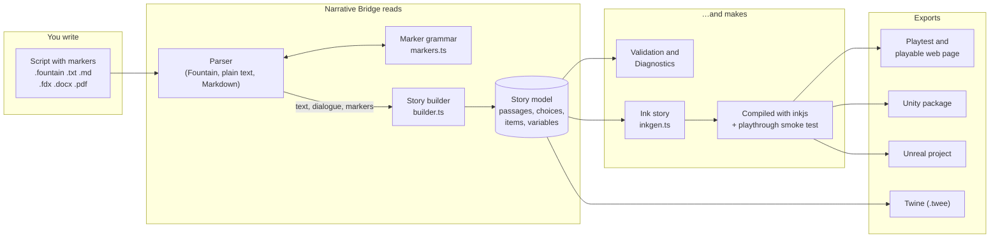
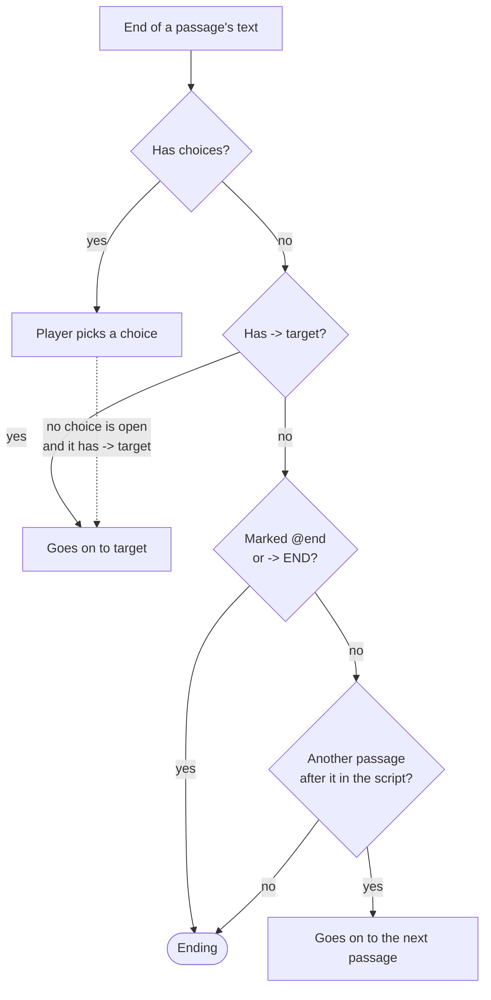
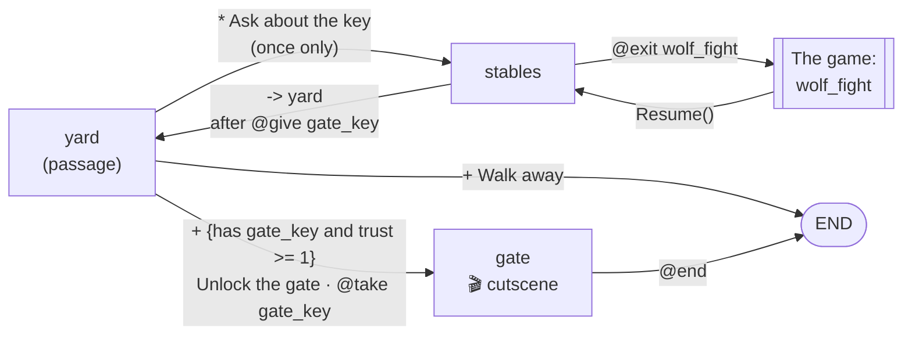
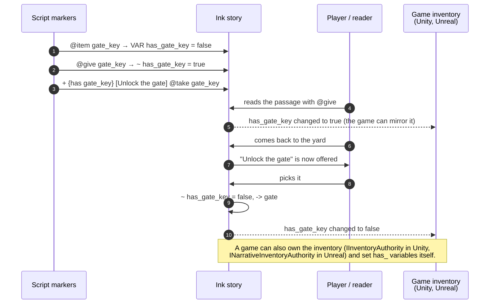
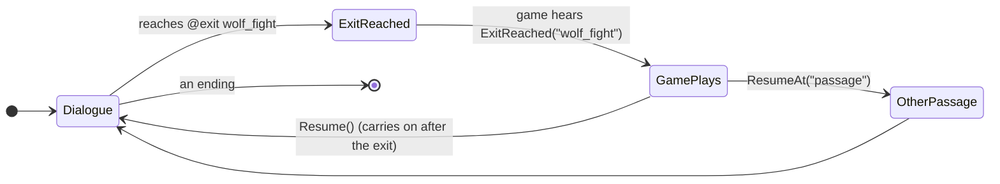

# Structured markers

**Structured import is the default way to use Narrative Bridge.** You write your script as usual, and add short markers on
their own lines wherever you want to decide the structure yourself: where a passage starts, which choices the player gets,
what an item unlocks, where the game takes over. The app builds the story exactly as you mark it.

You don't have to mark everything. A script with no markers at all still converts, one passage per scene (or per Markdown
heading), and you can add markers a few at a time as you plan the branches.

Markers work in every script format the app reads: Fountain (`.fountain`), plain text (`.txt`) and Markdown (`.md`), and
Final Draft, Word and PDF files, which are converted to one of those first. They also work in the other two conversion
modes, *Faithful* and *Interactive adaptation*; the mode mostly decides what the app adds on its own (nothing, or
suggestions for you to approve).

Contents

1. [From script to game](#1-from-script-to-game)
2. [Quick reference](#2-quick-reference)
3. [Passages and flow](#3-passages-and-flow)
4. [Choices](#4-choices)
5. [Items and variables](#5-items-and-variables)
6. [Conditions](#6-conditions)
7. [Pacing and the game: pauses, cutscenes, exits and cues](#7-pacing-and-the-game-pauses-cutscenes-exits-and-cues)
8. [A worked example](#8-a-worked-example)
9. [What the exports do with markers](#9-what-the-exports-do-with-markers)
10. [Mistakes the app catches](#10-mistakes-the-app-catches)

## 1. From script to game

Every format has its own parser, but they all share one marker grammar
([`src/core/parsing/markers.ts`](../src/core/parsing/markers.ts)). Markers become parts of the story model, the model becomes
one Ink story, and every export is made from that same Ink.



The Review, Graph and Playtest tabs all work on the story model in the middle, so anything a marker sets up can also be
changed there afterwards (and the reverse: Review's *+ Exit to game*, *+ Continue break* and *🎬 Cutscene* make the same
things the markers do).

## 2. Quick reference

Write each marker on a line of its own. Ids (passage, item and variable names) are letters, digits and underscores, and
don't start with a digit: `archive_key`, `act2_finale`.

| Marker | What it does |
| --- | --- |
| `@passage id Optional Title` | Starts a passage. Everything up to the next `@passage` belongs to it. |
| `@start id` | Makes `id` the passage the story starts at (default: the first passage). |
| `@end` | This passage is an ending. |
| `-> id` | When this passage is done, go on to `id`. `-> END` ends the story. |
| `* [Text] -> id` | A choice that disappears once picked. |
| `+ [Text] -> id` | A choice that can be picked every time the player comes back. |
| `+ {condition} [Text] -> id` | A choice shown only when the condition is true. |
| `… -> id @give x @take y @set v = 2 @add n 1` | A choice that changes items or variables when picked. |
| `… -> id @forced` | While its condition is true, the only choice in the passage. |
| `- [Text](#id)` | A choice written as a Markdown link. |
| `@item id "Display Name" consumable` | Declares an inventory item. |
| `@var id = value` | Declares a variable: `true`/`false`, a whole number, or `"text"`. |
| `@give id` / `@take id` | Gives or takes an item at this point in the passage. |
| `@set id = value` / `@add id n` | Sets a variable, or adds to it (`n` can be negative). |
| `@pause` | A Continue break: what follows waits for the player. |
| `@cutscene` | This passage is a cutscene: only its dialogue, playing by itself. |
| `@exit name Note for the game` | An exit to the game: the dialogue stops until the game resumes it. |
| `@cue name value` | A cue for the game, such as music or a screen shake (an Ink tag `#name:value`). |
| `## Heading {#id}` | Markdown only: a heading that becomes a passage with the id you choose. |

The same list is at the bottom of the Import page, under **Structured marker reference**. *The Locked Archive* sample uses
most of them.

## 3. Passages and flow

### `@passage`

```text
@passage archive_entry Archive Entrance
```

Starts a passage with the id `archive_entry` and the title *Archive Entrance*. The id is what choices and diverts point
at; the title is what Review and the story map show. Without a title the id is used, tidied up (`archive_entry` →
*Archive Entry*).

As soon as a script has one `@passage`, **only** `@passage` lines start passages. Scene headings and Markdown headings
then stay inside the passage they're in (as text or a note), so you can split and join scenes freely. Without any
`@passage`, Markdown headings make the passages, otherwise scene headings do.

Anything written before the first `@passage` goes into a passage called *Opening*, except `@item`, `@var` and `@start`,
which are about the whole story and can sit at the top of the file without making one.

### `@start`

```text
@start cold_open
```

The story starts at `cold_open` instead of the first passage. Write it anywhere.

### `-> target` and `@end`

```text
-> vault          go on to the passage "vault"
-> END            end the story here
@end              end the story here
```

A passage ends in one of four ways, and the app checks them in this order:



So a script that's just passages one after another plays straight through, and the last passage is the ending. A passage
can have both choices and a `-> target`: the divert then becomes a hidden fallback, taken only when every choice is
closed (by its condition, or because it was a `*` choice already picked), so the player never gets stuck. A passage with
more than one `-> target` uses the last one (and Diagnostics says so).

## 4. Choices

```text
* [Ask about the key] -> stables
+ [Walk away] -> END
+ {has gate_key} [Unlock the gate] -> gate @take gate_key
```

- `*` makes a **once-only** choice: after it's been picked it's gone when the player returns to the passage.
- `+` makes a **sticky** choice that's offered every time.
- The text in `[…]` is what the player sees.
- `-> target` is where it goes. Leave it out, or write `-> END`, to end the story.
- `{…}` before the text is a [condition](#6-conditions): the choice is shown only when it's true. Several `{…}` must
  all be true: `+ {has lamp} {trust >= 2} [Go down] -> cellar`.
- After the target, any of `@give`, `@take`, `@set`, `@add` change the story's state when the choice is picked, in the
  order written: `+ [Pay the ferryman] -> river @take coin @add debt -1`.

### Forced choices: `@forced`

```text
+ {has archive_key} [Use the key] -> vault @forced
+ [Knock] -> vault
+ [Leave] -> END
```

While its condition is true, a forced choice is the **only** choice in the passage: once the player has the key, *Knock*
and *Leave* disappear. Without the key, the forced choice is hidden and the others are offered as usual. In the Ink this
becomes an extra `{not has_archive_key}` on each of the other choices.

### Markdown link choices

```markdown
- [Search the reading room](#find_key)
- [Leave](#outside) @give lantern
```

In Markdown, a `-` list item that's only a link to `#id` is a sticky choice to `id`. Effects and `@forced` can follow it.

### How passages, choices and exits connect



This is the story from the [worked example](#8-a-worked-example): passages are the boxes, choices and diverts the arrows,
and an exit hands the player to the game in the middle of a passage and back again.

## 5. Items and variables

### `@item`

```text
@item gate_key "Gate Key" consumable
```

Declares an item with the id `gate_key`, shown to players and in the game as *Gate Key* (without a name, the id is
tidied up). `consumable` is a label for the game, meaning the item is used up; it doesn't change how the story plays.

In Ink, every item is a true/false variable: `VAR has_gate_key = false`. The player starts without it.

### `@give` and `@take`

```text
@give gate_key
@take gate_key
```

On a line of their own they happen when the player reads that point of the passage; after a choice's target they happen
when the choice is picked. An item that's given or taken but never declared is declared for you (Diagnostics notes it),
but an item that's only used in a condition must be declared with `@item`.

### `@var`, `@set` and `@add`

```text
@var trust = 0            a number (whole numbers only)
@var met_rosa = false     true or false
@var mood = "calm"        text
@set trust = 2
@set met_rosa             with no value, sets it to true
@add trust 1
@add trust -1
```

`@var` declares a variable and its starting value, which also decides its type. `@set` gives it a new value; `@add`
adds a number (1 if you leave the number out). A variable that's set but never declared is declared for you, starting at
`0`, `false` or `""`.

### The item and condition flow



## 6. Conditions

A condition goes in `{…}` before a choice's text.

| Write | True when |
| --- | --- |
| `has gate_key` | the player has the item |
| `gate_key` | the same, if `gate_key` is an item; if it's a true/false variable, when it's true |
| `not has lamp` or `!has lamp` | the player doesn't have it |
| `trust >= 2` | comparing a variable: `==`, `!=`, `>`, `>=`, `<`, `<=` |
| `mood == "calm"` | text compares with quotes |
| `has key and trust >= 1` | both are true (`and` or `&&`) |
| `has key or trust >= 3` | either is true (`or` or `\|\|`) |

`and` binds tighter than `or`, so `has a or has b and trust > 1` means *has a*, or else *has b with trust over 1*. There
are no brackets; use two `{…}` blocks when you need both parts to hold.

## 7. Pacing and the game: pauses, cutscenes, exits and cues

### `@pause`: a Continue break

```text
The door swings open.
@pause
Inside, a single ledger glows.
```

The player sees *Continue* and the rest of the passage waits for them. In Ink it's a lone `+ [Continue]` choice followed by
a gather `-`, so every Ink player shows it as a button.

### `@cutscene`

```text
@passage farewell The Farewell
@cutscene
```

The whole passage plays as a cutscene: only its dialogue is kept, each line tagged `#cutscene`, and readers show the lines
one at a time, going on by themselves (1.2 s plus 0.055 s a letter, between 2 and 9 s) with a Skip button. Narration and
other text become comments players don't see, and `@pause` breaks in it are dropped. It can go anywhere in the passage.

### `@exit`: hand over to the game

```text
@exit wolf_fight The player fights the wolves in the paddock.
```

The dialogue stops here and the game takes over: `wolf_fight` is the exit's name (made safe for code: letters, digits and
underscores), and anything after it is a note for the game's developer. When the game is done it resumes the story where
it stopped, or at another passage.



In Ink it's a single choice `+ [Back to the game: wolf_fight] // note` and a gather. A player with no game (Playtest, the
playable web page) shows a *Resume* button there.

### `@cue`: tell the game something

```text
@cue music dusk
@cue shake
@cue stop_music
```

A cue is an Ink tag (`# music:dusk`) attached to the next line, for the game to act on. Its name decides what Playtest and
the exports do with it: names with `music` or `ambience` loop a track, `stop_music` and `stop_ambience` stop them, `shake`
shakes the screen, and anything else plays a sound. Attach the sound to a cue in Review; every cue with the same name and
value then plays it.

## 8. A worked example

A short Fountain script, `gatehouse.fountain`, using most of the markers:

```fountain
Title: The Gatehouse

@item gate_key "Gate Key" consumable
@var trust = 0

@passage yard The Yard
@cue music dusk

Rain hammers the cobbles. A GUARD blocks the gate.

GUARD
Nobody passes without a key.

* [Ask about the key] -> stables
+ {has gate_key and trust >= 1} [Unlock the gate] -> gate @take gate_key
+ [Walk away] -> END

@passage stables The Stables

A stable hand, ROSA, is brushing a horse.

ROSA
The key? Help me with the wolves first.

@exit wolf_fight The player fights the wolves in the paddock.

ROSA
You did it. Here.

@give gate_key
@add trust 1
-> yard

@passage gate The Gate
@cutscene

The gate groans open.

GUARD
Go on, then.

ROSA
Good luck out there.

@end
```

Converting it (on the Import page, or `npm run cli -- convert gatehouse.fountain --out gatehouse.ink`) gives this Ink, word
for word:

```ink
// The Gatehouse
// Generated by Narrative Bridge 0.4.0 from ISR schema 1.0 (structured conversion).
// Edit the source document or the Narrative Bridge project, not this file — it is regenerated.
# title: The Gatehouse

// Inventory: one Boolean per item (the host game may mirror these; see NarrativeController).
VAR has_gate_key = false // Gate Key (consumable)
VAR trust = 0

-> yard

=== yard ===
// The Yard (source line 6)
# music:dusk
Rain hammers the cobbles. A GUARD blocks the gate.
GUARD: Nobody passes without a key. #speaker:guard
* [Ask about the key]
    -> stables
+ {(has_gate_key && (trust >= 1))} [Unlock the gate]
    ~ has_gate_key = false
    -> gate
+ [Walk away]
    -> END

=== stables ===
// The Stables (source line 18)
A stable hand, ROSA, is brushing a horse.
ROSA: The key? Help me with the wolves first. #speaker:rosa
+ [Back to the game: wolf_fight] // The player fights the wolves in the paddock.
-
ROSA: You did it. Here. #speaker:rosa
~ has_gate_key = true
~ trust += 1
-> yard

=== gate ===
// The Gate (source line 34)
// Players don’t see this: The gate groans open.
GUARD: Go on, then. #speaker:guard #cutscene
ROSA: Good luck out there. #speaker:rosa #cutscene
-> END
```

Reading it side by side with the script:

| In the script | In the Ink |
| --- | --- |
| `@item gate_key "Gate Key" consumable` | `VAR has_gate_key = false // Gate Key (consumable)` |
| `@var trust = 0` | `VAR trust = 0` |
| `@passage yard The Yard` | `=== yard ===` and a `// The Yard` comment |
| `@cue music dusk` | `# music:dusk` |
| `GUARD` / `Nobody passes…` | `GUARD: Nobody passes without a key. #speaker:guard` |
| `* [Ask about the key] -> stables` | a once-only `*` choice |
| `+ {has gate_key and trust >= 1} […] @take gate_key` | a sticky `+` choice with a condition and `~ has_gate_key = false` |
| `@exit wolf_fight …` | `+ [Back to the game: wolf_fight] // …` and a gather `-` |
| `@give gate_key`, `@add trust 1` | `~ has_gate_key = true`, `~ trust += 1` |
| `-> yard` | `-> yard` |
| `@cutscene` | `#cutscene` on each line of dialogue; the narration becomes a comment |
| `@end` | `-> END` |

The story map for this script is the diagram in [How passages, choices and exits connect](#how-passages-choices-and-exits-connect).
The same story as Markdown would use `## The Yard {#yard}` headings (or `@passage` lines) and `**GUARD:** Nobody passes…`
for dialogue; the markers are the same.

## 9. What the exports do with markers

| Marker | Playtest and web page | Twine (SugarCube) | Unity | Unreal |
| --- | --- | --- | --- | --- |
| Passages, choices, `-> target` | Pages and choice buttons | Passages and links | `NarrativeController` choices | `UNarrativeBridgeComponent` choices |
| `{condition}` | Choice hidden until true | `<<if>>` around the link | Choice offered only when true | Choice offered only when true; locked choices listed with what they need |
| Items | Inventory panel | `$has_<item>` set in `StoryInit` | `IInventoryAuthority` bridge | `INarrativeInventoryAuthority` |
| `@pause` | *Continue* button | `Name (continued)` passage and a Continue link | Continue button | Continue button |
| `@cutscene` | Lines one at a time, with Skip | Lines appear one after another (`<<timed>>`) | Story panel plays it by itself | Story panel plays it by itself |
| `@exit` | *Resume* button | A Continue link with a note (Twine has no game) | `ExitReached(name)`, `Resume()`, `ResumeAt()` | `Resume`, `ResumeAt` |
| `@cue` | Plays the attached sound | Not used | `NarrativeCuePlayer`, `TagFound` | Cue player |

See [Engine exports](../README.md#engine-exports) in the README for the packages themselves, and
[Ink conventions](../README.md#ink-conventions) for the exact Ink each marker becomes.

## 10. Mistakes the app catches

Markers are checked on every conversion and after every edit, and anything wrong shows in the **Diagnostics** panel with
the line it came from:

- the same `@passage` id declared twice (must be fixed before exporting);
- a choice or `-> target` pointing at a passage that doesn't exist (must be fixed);
- a condition using an item or variable that was never declared (must be fixed: add `@item` or `@var`);
- an item a choice needs that nothing ever gives, so the choice can never be taken;
- passages no route reaches, and playthroughs that never reach an ending (the smoke test plays every route);
- items or variables declared but never used, and ones declared for you because an effect used them;
- more than one `-> target` in a passage (the last one wins);
- a cue with no sound attached (a note, not a problem).

A misspelt marker (say `@pasage`) isn't recognised, so it's kept as ordinary text and shows up in Review and Playtest where
you'll spot it.
