# Narrative Bridge user guide

Narrative Bridge turns a screenplay or a piece of prose into an interactive story. You bring a script, check what the app
understood, add choices, play it, and then share it as a web page or hand it to a game developer as a Unity or Unreal
project.

Everything happens in your browser. Your scripts are never uploaded.

**Contents**

1. [Opening the app](#1-opening-the-app)
2. [A tour of the screen](#2-a-tour-of-the-screen)
3. [Import: bring your script](#3-import-bring-your-script)
4. [Review: check and edit the story](#4-review-check-and-edit-the-story)
5. [Graph: the story map](#5-graph-the-story-map)
6. [Ink: the generated story file](#6-ink-the-generated-story-file)
7. [Playtest: play it as a player would](#7-playtest-play-it-as-a-player-would)
8. [Export: share it or send it to a developer](#8-export-share-it-or-send-it-to-a-developer)
9. [Diagnostics and the Logbook](#9-diagnostics-and-the-logbook)
10. [Saving, drafts and working offline](#10-saving-drafts-and-working-offline)
11. [Voices and recorded dialogue](#11-voices-and-recorded-dialogue)
12. [Keyboard shortcuts](#12-keyboard-shortcuts)
13. [Structured markers](#13-structured-markers)
14. [Troubleshooting](#14-troubleshooting)

---

## 1. Opening the app

There are two ways to use Narrative Bridge, and both work the same:

- **Online:** open https://flamingairplane.github.io/Script-to-Game-Converter/. After your first visit it also works
  without an internet connection, and your browser may offer to install it as an app (in Chrome or Edge, the install
  icon in the address bar; on iPhone or iPad, Share → *Add to Home Screen*).
- **Offline file:** download **Narrative Bridge (double-click to open)** from the
  [latest release](https://github.com/FlamingAirplane/Script-to-Game-Converter/releases/latest), save it somewhere easy
  to find, and double-click it. It opens in Safari, Chrome, Edge or Firefox. Nothing is installed.

The first screen shows a short *New here? Four steps* card. Click **Got it** to hide it; **How it works** brings it back.

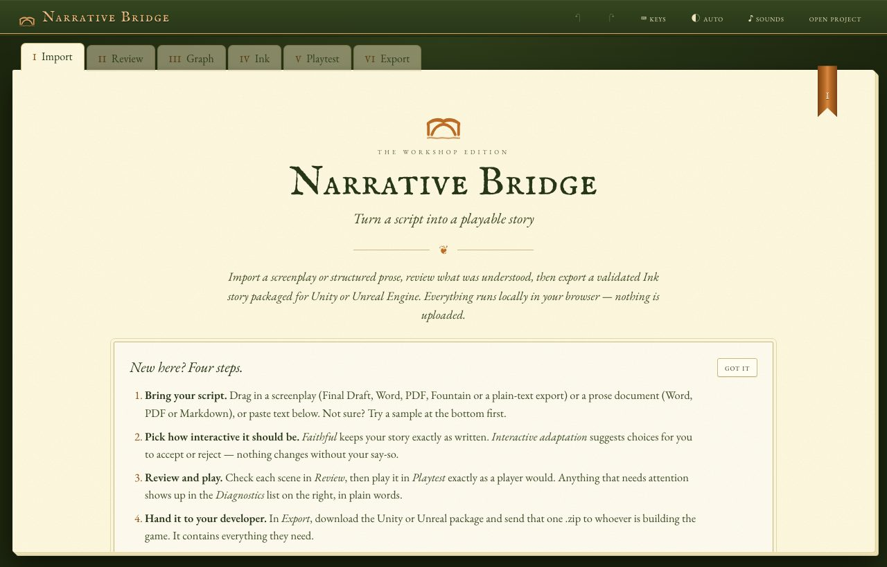

## 2. A tour of the screen

- **The cover band** (the dark green bar at the top) shows the story's title and its progress (for example
  *ReviewRequired* or *Succeeded*). *✓ kept in this browser* means your work is being saved automatically. It also holds
  undo ↶ and redo ↷, **keys** (the shortcut card), the theme switch (**auto**, **light** or **dark**), **sounds**,
  **Open project**, **Save project** and **New**.
- **The chapter tabs** (I Import to VI Export) follow the order you'll usually work in. The copper ribbon marks the open
  chapter. A number on the Review tab counts suggestions waiting for your OK.
- **The side panel** on the right lists **Diagnostics** (anything that needs attention) and the **Logbook**. Close it
  with ×, and bring it back with the *Diagnostics* button beside the tabs.

## 3. Import: bring your script

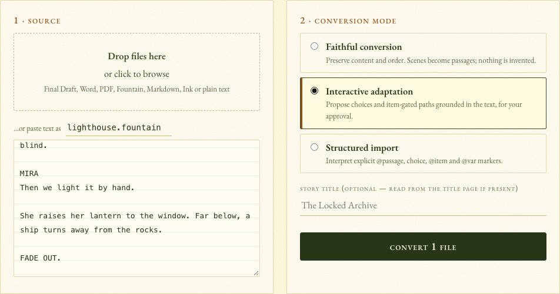

### Step 1: Source

Drop files onto the box, click it to choose files, or paste text into the box below it. When you paste, the name next to
*…or paste text as* tells the app what kind of text it is (for example `script.fountain` or `notes.md`).

| You have | What happens |
| --- | --- |
| **Final Draft** (`.fdx`) | Scene headings, characters, dialogue, parentheticals, transitions and the title page are kept. |
| **Word** (`.docx`) | A screenplay using Word's screenplay styles keeps its structure. Other documents become one passage per heading. |
| **PDF** (`.pdf`) | A screenplay in standard layout keeps its structure; page numbers and (MORE) / (CONT'D) are removed. A novel becomes one passage per chapter heading. |
| **Fountain** (`.fountain`) or plain text (`.txt`) | Read as a screenplay. |
| **Markdown** (`.md`) | Each heading becomes a passage. |
| **Ink** (`.ink`) | Used as it is, for checking, playtesting and exporting. |

You can add several files; they become one story in the order listed. Old `.doc` files and scanned PDFs (pictures of
pages) can't be read. Save as `.docx`, or export from your writing app, instead. If you have both an `.fdx` and a PDF,
the `.fdx` is more exact.

Not ready to use your own script? Scroll down to **Or start from a sample**.

### Step 2: Conversion mode

- **Faithful conversion** keeps your story exactly as written. Each scene becomes a passage, in order. Nothing is
  invented.
- **Interactive adaptation** also suggests choices grounded in your text, such as picking up an item and a later path
  that needs it. Suggestions are marked *generated* and *pending*, and **nothing is added until you approve it**.
- **Structured import** follows markers you write into the script (`@passage`, `@item`, choices and so on). See
  [Structured markers](#13-structured-markers). Markers also work in the other two modes.

Optionally type a **Story title** (otherwise it comes from the title page), then click **Convert**.

## 4. Review: check and edit the story

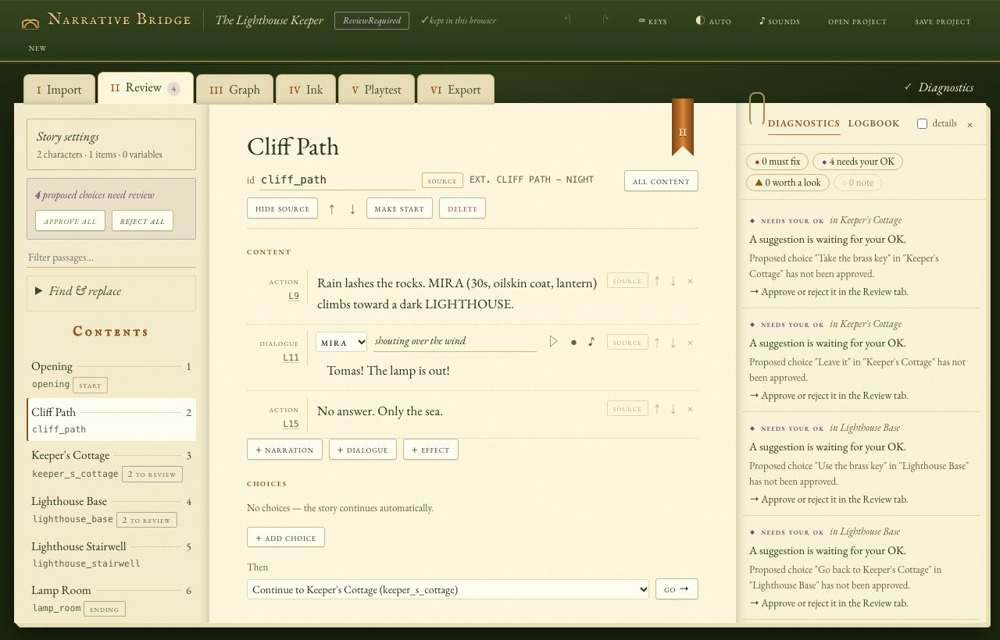

**The contents list** (left) shows every passage in order, with *start*, *ending* and *unreachable* tags and a count of
suggestions to review. Type in *Filter passages…* to narrow it down. Press **[** and **]** to step through passages.

**A passage** (middle) has:

- **Its title and id.** The id is how choices refer to it; renaming it updates every reference.
- **Buttons:** **All content / Dialogue only** (hide everything except spoken lines), **Hide source** (the original
  script beside the passage), ↑ ↓ to reorder, **Make start**, and **Delete**.
- **Content:** each block is *action* (narration), *dialogue*, a *transition*, a *note* (kept as a comment) or an
  *effect* (such as giving an item). Click text to edit it. The **L12** link on each block jumps to that line of the
  original script. Add blocks with **+ narration**, **+ dialogue** and **+ effect**.
- **Choices:** each has its wording, where it leads (→, with ↗ to jump there), conditions (**+ condition**, for example
  *has the brass key*), effects (**+ effect**), and **once only** (the choice disappears after it is picked). Add one with
  **+ Add choice**. **Then** sets where the story goes when there are no choices, or **End the story here**.

### Approving suggestions

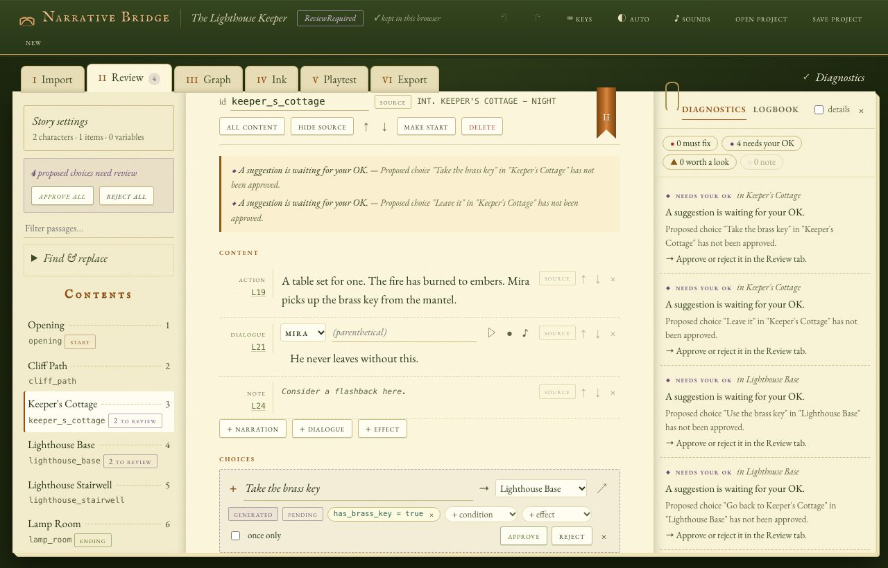

In Interactive adaptation, suggested choices are marked *generated* and *pending*. Click **Approve** or **Reject** on
each one, or use **Approve all** / **Reject all** at the top of the contents. Pending suggestions are left out of every
export until approved.

### Story settings

Click **Story settings** at the top of the contents.

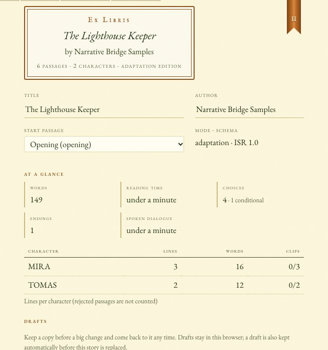

- **Title, Author, Start passage.**
- **At a glance:** words, reading time, choices, endings, minutes of spoken dialogue, and a table of lines, words and
  recorded clips per character. Useful when planning a voice session.
- **Drafts:** see [Saving, drafts and working offline](#10-saving-drafts-and-working-offline).
- **Characters:** display names, aliases found in the script, a voice for each, and **merge into…** for duplicates
  (such as "MIRA" and "MIRA (V.O.)").
- **Items** (things the player can carry, like a key) and **Variables** (numbers, true/false values or text the story
  tracks).

### Find & replace

Open **Find & replace** in the contents column (⌘F / Ctrl+F). It searches titles, text, parentheticals and choices, lists
every match, and **Replace all** changes them in one step. Undo ↶ reverses it.

## 5. Graph: the story map

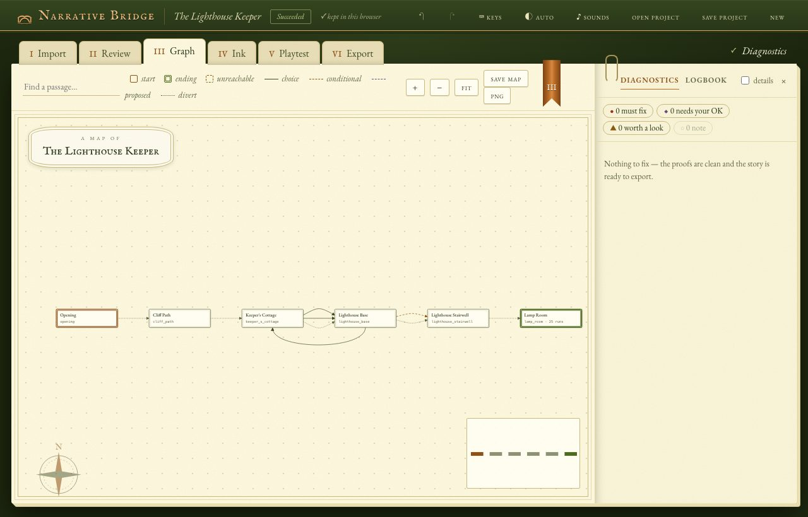

Every passage is a card and every choice a route between cards. The **key** under the map explains the marks:

| Mark | Means |
| --- | --- |
| **Start** tag | The story begins here. |
| **Ending** tag | The story can end here. |
| **Can't be reached** tag (dashed) | No route leads here yet. Add a choice to it, or delete it. |
| Solid route | A choice the player can make. |
| Dashed route with a padlock | A choice that needs an item or value, such as having the key. |
| Dotted route | The story continues on its own. |
| Dashed route with ◆ | A suggested choice, waiting for your OK in Review. |

Hover over a route to read its choice, and over a passage for a summary, including how many automated test plays ended
there. **Key** in the toolbar hides or shows the key; your choice is remembered.

- **Click** a passage to open it in Review. **Drag** it to rearrange the map; your layout is saved with the project.
  **Reset layout** returns to automatic placement.
- **Scroll** or **+ / −** to zoom, drag the background to move, **Fit** to see everything. Click the minimap to jump.
- **Find a passage…** highlights matches; press Enter to go to the first.
- **Save map** downloads the whole map as an SVG image; **PNG** as a picture.

## 6. Ink: the generated story file

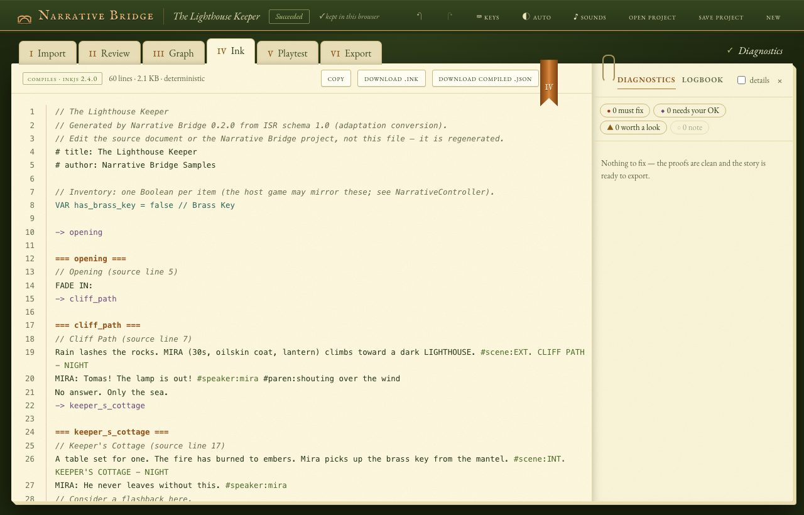

This is the story in [Ink](https://www.inklestudios.com/ink/), the scripting language the game engines read. It is
regenerated whenever you edit, always the same way for the same story. The badge says whether it compiles. **Copy**,
**Download .ink** and **Download compiled .json** are there if a developer asks for them; otherwise you don't need this
chapter.

## 7. Playtest: play it as a player would

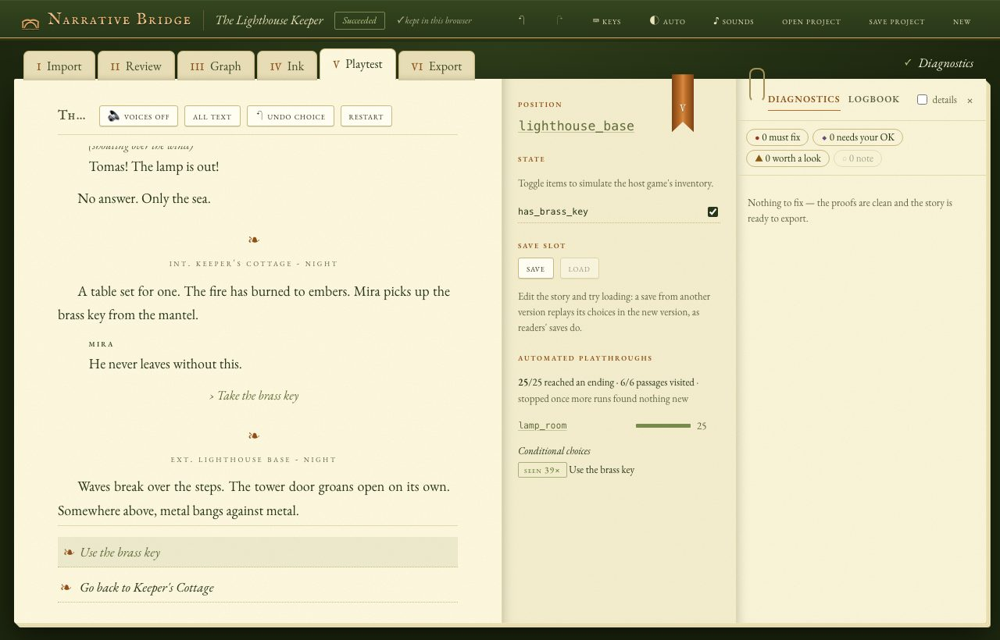

Click a choice (or press 1–9) to play. **Undo choice** (Backspace) steps back; **Restart** (R) begins again. **Voices**
(V) reads the dialogue aloud; **All text / Dialogue only** (D) hides narration.

The panel beside the story shows:

- **Position:** the passage you are in.
- **State:** every item and variable. Tick or change them to pretend the game gave or took something; the choices
  update straight away.
- **Save slot:** **Save** and **Load**. If you edit the story and then load, the save carries over the way a reader's
  would: your choices are replayed in the new version.
- **Automated playthroughs:** the app plays the story many times by itself and reports how many runs reached an ending,
  which passages were visited, which endings were reached, and how often each conditional choice appeared.

## 8. Export: share it or send it to a developer

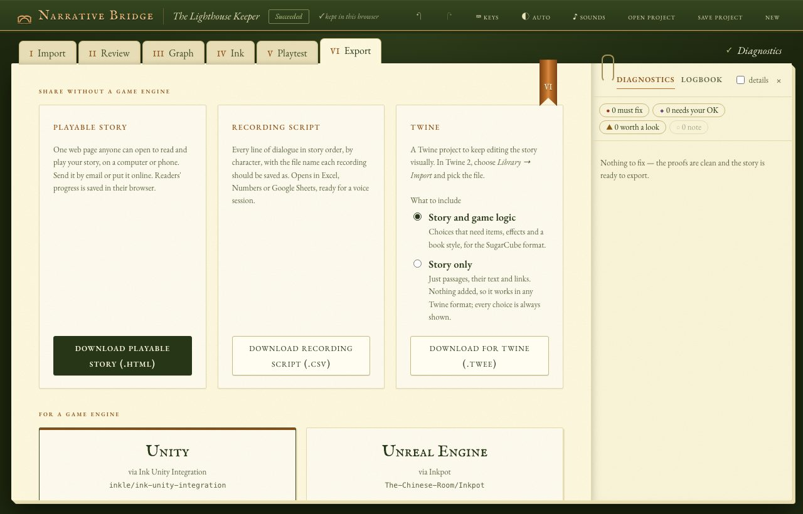

### Share without a game engine

- **Download playable story (.html):** one web page that anyone can open on a computer or phone to read and play your
  story. Email it or put it on any website. It saves each reader's progress, offers undo and *Start over*, and plays your
  recordings or voices. If you send a revised copy, readers keep their place; if you cut a choice they made, they pick up
  just before it.

  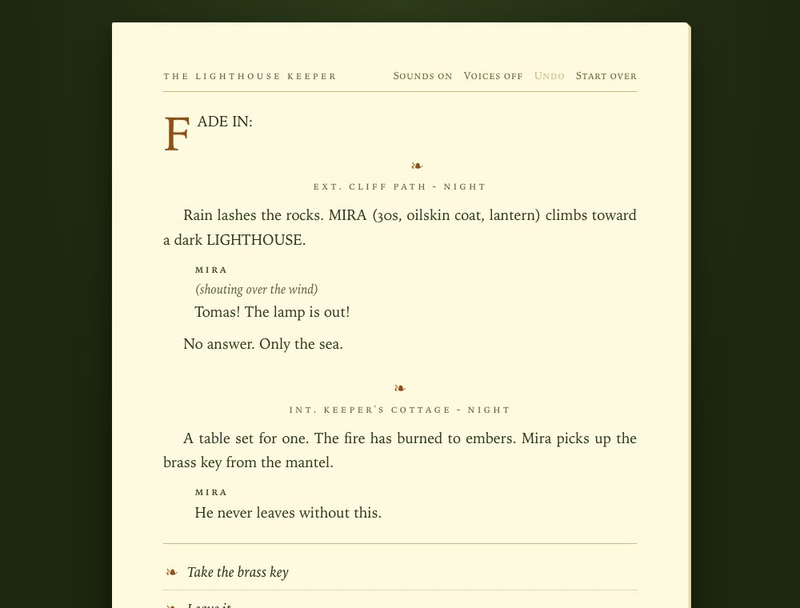

- **Download recording script (.csv):** every line of dialogue in story order, by character, with the file name each
  recording should be saved as. Opens in Excel, Numbers or Google Sheets.
- **Download for Twine (.twee):** to keep editing in [Twine](https://twinery.org) (Library → Import). Passages are
  laid out on Twine's map like your story map, and their text reads like your script. Choose what to include:
  - **Story and game logic:** choices that need items, effects and a book style, for Twine's SugarCube format.
  - **Story only:** just the passages, their text and the links between them. Nothing is added, so it works in any
    Twine format (including the default, Harlowe); every choice is always shown.

### For a game engine

1. Choose **Unity** or **Unreal Engine**.
2. Check the **Package settings**. The defaults are fine unless your developer asked for a particular engine version or
   integration release.
3. The **Preflight** list must be all ticks: the story compiles, nothing blocks export, and the automated playthroughs
   reach an ending.
4. Click **Build Unity package** (or Unreal). The app checks the package it built; *package verified* means it passed.
5. Click **Download .zip** and send that one file to your developer.

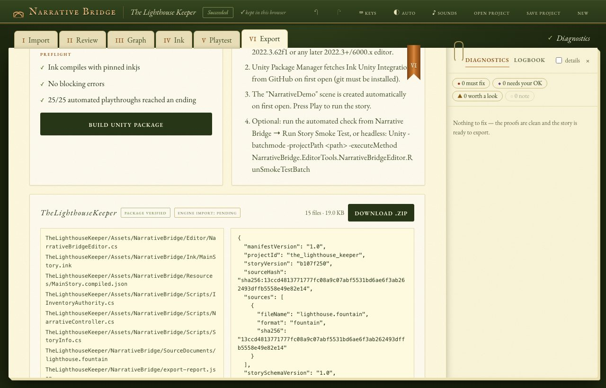

The zip contains the game project, your story, your original script, any voice recordings, a validation report, and
setup instructions for the developer.

## 9. Diagnostics and the Logbook

**Diagnostics** lists anything worth your attention, in plain words, with what to do about it:

| Mark | Means |
| --- | --- |
| ● **must fix** | Stops export. For example, a choice leads to a passage that doesn't exist. |
| ◆ **needs your OK** | A suggestion waiting for approval. |
| ▲ **worth a look** | Probably fine, but check it. For example, a passage no choice leads to. |
| ○ **note** | Information only. |

Click an entry to jump to the passage it concerns. Tick **details** to see technical codes. *Nothing to fix* means the
story is ready to export. ⌘. (Ctrl+.) shows or hides the panel.

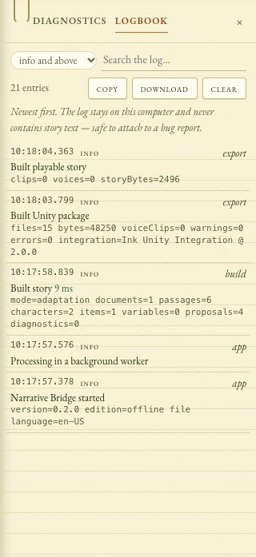

The **Logbook** (⌘L / Ctrl+L) records what the app has done: imports, processing, exports and errors. It never contains
your story's text, so it is safe to attach to a bug report. Choose how much to show, search it, or **copy**,
**download** or **clear** it.

## 10. Saving, drafts and working offline

- **Autosave:** your project is remembered in this browser. *✓ kept in this browser* confirms it; if the browser runs
  out of room, a warning appears instead and you should use **Save project**.
- **Save project** (⌘S / Ctrl+S) downloads a `.nbproj.json` file containing everything, including recordings.
  **Open project** (⌘O / Ctrl+O) loads one. Use this to move work to another computer, share it with a collaborator, or
  keep a backup. Clearing your browser's history, or using a private window, loses the remembered copy.
- **Drafts** (in Story settings): type a name and click **Keep a draft** before a big change. **Restore** brings a draft
  back, and undo ↶ reverses the restore. A draft is also kept automatically before your story is replaced by a new
  conversion or an opened project file. On the Import page, *Or pick up earlier work* lists earlier stories.
- **Undo and redo** (⌘Z / ⇧⌘Z) cover every edit in Review and Graph.
- **New** returns to Import to start another story; the current one is kept as a draft when you convert.

## 11. Voices and recorded dialogue

- **Character voices:** in Story settings, pick a voice, speed and pitch for each character and press ▷ to hear it.
  These use your computer's built-in voices.
- **Recordings:** beside any line of dialogue in Review, press **●** to record it with your microphone, **♪** to attach
  an audio file (WAV, MP3 or OGG; other formats are converted), and ▶ to play it back. A line with a recording uses it
  instead of the voice.
- Recordings travel with the playable story, the Unity and Unreal packages, and saved project files. The recording
  script export tells your voice actors which file name to use for each line.

## 12. Keyboard shortcuts

Press **?** at any time to see them all. On Windows and Linux, use Ctrl instead of ⌘.

| Anywhere | |
| --- | --- |
| ⌘1 – ⌘6 | Go to chapter I – VI |
| ⌘S / ⌘O | Save / open project |
| ⌘Z / ⇧⌘Z | Undo / redo |
| ⌘F | Find |
| ⌘. | Show or hide Diagnostics |
| ⌘L | Open the Logbook |

| Review | | Playtest | | Graph | |
| --- | --- | --- | --- | --- | --- |
| [ / ] | Previous / next passage | 1 – 9 | Pick a choice | / | Find a passage |
| D | Dialogue only | Backspace | Undo a choice | F | Fit the map |
| | | R | Restart | + / − | Zoom |
| | | V | Voices on / off | Tab, Enter | Move between passages, open one |

## 13. Structured markers

Write these on their own lines in any script to control the structure exactly (they work in every mode, and drive
*Structured import*):

```text
@passage archive_entry Archive Entrance     start a passage (id + optional title)
@start archive_entry                         choose the start passage
@item archive_key "Archive Key" consumable   declare an item (consumable is a label for the game)
@var trust = 0                               declare a variable (true/false, a number or "text")
@give archive_key   @take archive_key        give or take an item
@set trust = 2      @add trust 1             change a variable
* [Choice text] -> target                    a choice that disappears once picked
+ [Choice text] -> target                    a choice that can be picked again
+ {has archive_key} [Open it] -> vault @take archive_key
+ {trust >= 2 and not has lamp} [Trust her] -> ally
- [Markdown link choice](#target)
-> target                                    continue to another passage
@end                                         end the story here
## Heading {#custom_id}                      a Markdown heading as a passage with a chosen id
```

The **Structured marker reference** at the bottom of the Import page has the same list. *The Locked Archive* sample uses
them throughout.

## 14. Troubleshooting

- **The offline file opens as text or code.** Right-click it → *Open With* → your web browser.
- **Nothing appears.** Try another browser, and check the whole file downloaded (it is about 3 MB).
- **A file won't import.** The message under the drop box says why. Scanned PDFs and old `.doc` files can't be read.
- **Export buttons are greyed out.** Fix the ● *must fix* items in Diagnostics. Buttons are also disabled for a moment
  while the app re-checks the story after an edit.
- **A choice I expected isn't in the game.** It may still be *pending*: approve it in Review.
- **The page offers "A new edition of Narrative Bridge is ready".** Click **Reload**; your work is kept.
- **Reporting a problem:** open the Logbook (⌘L / Ctrl+L), click **download**, and attach the file to a
  [new issue](https://github.com/FlamingAirplane/Script-to-Game-Converter/issues). It contains no story text.
